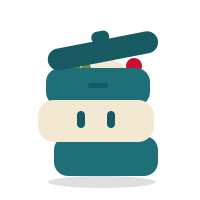

<p align="center">
  
</p>

<h1 align="center">Yōkipack</h1>

<p align="center">
  Detects your project and suggests a Dockerfile you can review and change.<br>
  <sub><i>Yōki</i> (容器) is Japanese for "container".</sub>
</p>

<p align="center">
  <a href="https://go.dev/dl/"></a>
  <a href="LICENSE"></a>
  
</p>

Yōkipack looks at the files in a project, proposes a base image and install,
build and run commands, lets you review them, and writes a `Dockerfile` and
`.dockerignore`.

The detected settings are **suggestions**. You can change any of them, and
projects in unsupported languages work too if you enter the settings yourself.
That's why the mascot, Nozoki (覗き, "peek"), keeps its lid open: the box is
packed, but you can still look inside.

Yōkipack is the Dockerfile generator behind [Yōkify](https://github.com/uchkunovdaniel/yokify),
and also works as a standalone CLI, like a configurable `docker init`.

## Install

```sh
go install github.com/uchkunovdaniel/yokipack/cmd/yokipack@latest
```

Requires Go 1.26 or newer.

## Usage

```sh
yokipack              # asks for the project directory, then the settings
yokipack ./app        # use ./app, then review the settings
yokipack -y ./app     # accept the suggested settings without prompting
yokipack -n ./app     # print the Dockerfile instead of writing it
```

For a project the detector doesn't know, give the settings as flags:

```sh
yokipack -y -m docker.io/library/rust:1 -b "cargo build --release" -r ./target/release/app
```

Then build and run it with Podman or Docker:

```sh
podman build -t myapp .
podman run --init -p 8080:8080 myapp
```

### Flags

| Flag | Short | Default | Description |
|---|---|---|---|
| `--file` | `-f` | `Dockerfile` | file to write |
| `--port` | `-p` | `8080` | port the app listens on (`ENV PORT`, `EXPOSE`) |
| `--yes` | `-y` | | accept settings without prompting |
| `--dry-run` | `-n` | | print instead of writing |
| `--force` | | | replace an existing Dockerfile |
| `--image` | `-m` | detected | base image |
| `--install` | `-i` | detected | install command |
| `--build` | `-b` | detected | build command |
| `--run` | `-r` | detected | run command |

An existing `Containerfile` or `Dockerfile` is never replaced without `--force`.
An existing `.dockerignore` is never replaced.

### Shell completion

```sh
yokipack completion zsh > "${fpath[1]}/_yokipack"   # see `yokipack completion --help` for other shells
```

## Supported projects

| Ecosystem | Detected by | Toolchains |
|---|---|---|
| Node.js | `package.json` | npm, pnpm, yarn, bun (by `packageManager` field or lockfile) |

For Node.js, the run command is the `start` script, then `preview`, then `dev`.
More ecosystems are planned. See [CONTRIBUTING.md](docs/CONTRIBUTING.md) to add one.

## Example

For a project with `package.json` (with `build` and `start` scripts) and
`package-lock.json`:

```dockerfile
FROM docker.io/library/node:24-alpine
WORKDIR /app

COPY package.json ./package.json
COPY package-lock.json ./package-lock.json
RUN npm ci

COPY . .
RUN npm run build

ENV PORT=8080
EXPOSE 8080
CMD npm run start
```

Dependency files are copied before the rest of the source, so the install step
stays cached until they change.

## Use as a library

```go
import (
	"os"

	"github.com/uchkunovdaniel/yokipack"
)

fsys := os.DirFS("path/to/project")

if name, ok := yokipack.FindContainerFile(fsys); ok {
	// the project already has a Containerfile or Dockerfile
}

plan, ok := yokipack.Detect(fsys) // ok is false if nothing was detected
plan.Run = "node dist/main.js"    // override any suggestion

dockerfile, err := yokipack.Render(plan, yokipack.RenderOptions{Port: 3000})
ignore, err := yokipack.RenderIgnore()
```

`Render` returns an error if the plan has no image or run command, or if a
value would break the Dockerfile (for example a newline).

## Development

```sh
go test ./...                          # all tests
go test ./internal/render/ -update     # regenerate golden files after template changes
go run ./cmd/yokipack -n test          # try the CLI on a local project
```

## Part of Yōkify

<table>
  <tr>
    <td align="center" width="50%">
      <br>
      <b>Yōkipack</b><br>
      <sub>&nbsp;&nbsp;&nbsp;&nbsp;&nbsp;&nbsp;&nbsp;&nbsp;&nbsp;&nbsp;&nbsp;&nbsp;&nbsp;packs your app&nbsp;&nbsp;&nbsp;&nbsp;&nbsp;&nbsp;&nbsp;&nbsp;&nbsp;&nbsp;&nbsp;&nbsp;</sub>
    </td>
    <td align="center" width="50%">
      <a href="https://github.com/uchkunovdaniel/yokify"></a><br>
      <b><a href="https://github.com/uchkunovdaniel/yokify">Yōkify</a></b><br>
      <sub>runs it</sub>
    </td>
  </tr>
</table>

[Yōkify](https://github.com/uchkunovdaniel/yokify) is a self-hosted serverless
platform for running anything locally on Podman. It uses Yōkipack to write the
Dockerfile for each project. Its mascot, Hakobi (運び, "carrying"), is a tanuki
courier carrying Nozoki.

## License

[MIT](LICENSE)